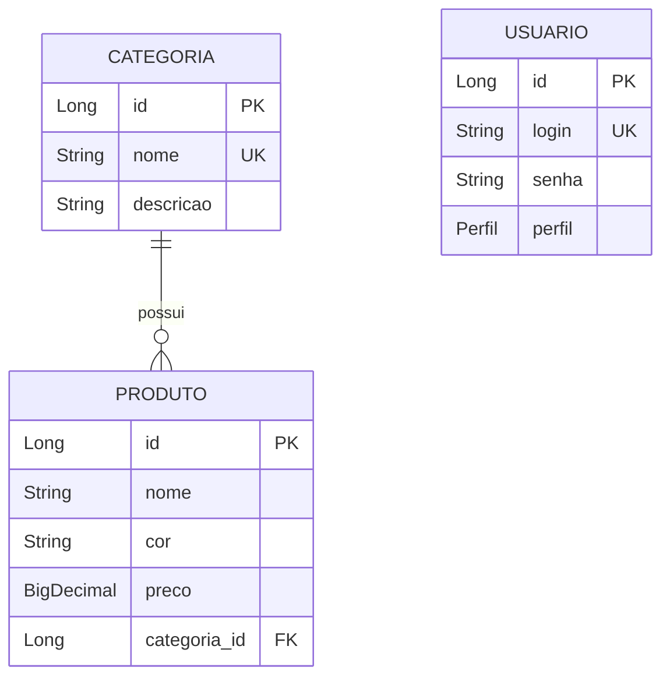

# 🧩 Modelagem de Dados: Loja API

> Etapa **A0** do [ROADMAP](ROADMAP.md). Tema: Loja (Categoria 1:N Produto) com login por perfil.

---

## 1. Diagrama entidade-relacionamento



- **Categoria (1) → (N) Produto:** uma categoria tem vários produtos. Cada produto pertence a **uma** categoria.
- **Usuario** não se relaciona com as outras entidades. Ele só controla o acesso.

---

## 2. Entidades (JPA)

### 2.1 Categoria

| Atributo | Tipo | Regras |
|---|---|---|
| `id` | `Long` | PK, gerado automaticamente (`IDENTITY`) |
| `nome` | `String` | Obrigatório, único, até 100 caracteres |
| `descricao` | `String` | Opcional, até 255 caracteres |
| `produtos` | `List<Produto>` | `@OneToMany(mappedBy = "categoria")`, lado inverso |

### 2.2 Produto

| Atributo | Tipo | Regras |
|---|---|---|
| `id` | `Long` | PK, gerado automaticamente |
| `nome` | `String` | Obrigatório, até 100 caracteres |
| `cor` | `String` | Obrigatório, até 30 caracteres (usado no filtro) |
| `preco` | `BigDecimal` | Obrigatório, maior que 0 |
| `categoria` | `Categoria` | `@ManyToOne(fetch = LAZY)`, obrigatório, **lado dono** (coluna `categoria_id`) |

### 2.3 Usuario

| Atributo | Tipo | Regras |
|---|---|---|
| `id` | `Long` | PK, gerado automaticamente |
| `login` | `String` | Obrigatório, único |
| `senha` | `String` | Obrigatório, guardada em **hash BCrypt** |
| `perfil` | `Perfil` (enum) | `ADMIN` ou `COMUM`, `@Enumerated(EnumType.STRING)` |

> ⚠️ Nunca devolva `senha` em nenhuma resposta da API.

---

## 3. DTOs (`record`)

As entidades não aparecem em requisições nem em respostas.

### Categoria
```java
public record CategoriaRequest(
    @NotBlank @Size(max = 100) String nome,
    @Size(max = 255) String descricao
) {}

public record CategoriaResponse(Long id, String nome, String descricao) {}
```

### Produto
```java
public record ProdutoRequest(
    @NotBlank @Size(max = 100) String nome,
    @NotBlank @Size(max = 30) String cor,
    @NotNull @Positive BigDecimal preco,
    @NotNull Long categoriaId
) {}

public record ProdutoResponse(
    Long id, String nome, String cor, BigDecimal preco,
    Long categoriaId, String categoriaNome
) {}
```

### Autenticação
```java
public record LoginRequest(@NotBlank String login, @NotBlank String senha) {}

public record LoginResponse(String token, String login, String perfil) {}
```

---

## 4. Endpoints

| Método | Rota | Descrição | Sucesso | Acesso |
|---|---|---|---|---|
| `POST` | `/auth/login` | Autentica e devolve o JWT | `200` | Público |
| `GET` | `/categorias` | Lista categorias | `200` | Autenticado |
| `GET` | `/categorias/{id}` | Busca categoria por ID | `200` | Autenticado |
| `POST` | `/categorias` | Cria categoria | `201` | `ADMIN` |
| `GET` | `/categorias/{id}/produtos` | **Consulta 1:** produtos de uma categoria (filtro no path) | `200` | Autenticado |
| `GET` | `/produtos` | Lista produtos. Com `?nome=&cor=`, faz a **Consulta 2** | `200` | Autenticado |
| `GET` | `/produtos/{id}` | Busca produto por ID | `200` | Autenticado |
| `POST` | `/produtos` | Cria produto | `201` | `ADMIN` |
| `PUT` | `/produtos/{id}` | Atualiza produto | `200` | `ADMIN` |
| `DELETE` | `/produtos/{id}` | Exclui produto | `204` | `ADMIN` |

### Consulta 2: comportamento dos filtros
`GET /produtos?nome=caneta&cor=azul`

| Parâmetros enviados | Resultado |
|---|---|
| nenhum | Todos os produtos |
| só `nome` | Produtos cujo nome **contém** o texto (sem diferenciar maiúsculas) |
| só `cor` | Produtos cuja cor **contém** o texto (sem diferenciar maiúsculas) |
| `nome` e `cor` | Produtos que atendem aos dois |

> Perfil `COMUM` só consulta. Perfil `ADMIN` também cria, altera e exclui (extra de 0,5).

---

## 5. Regras de negócio (camada Service)

| # | Regra | Erro |
|---|---|---|
| R1 | O preço do produto deve ser maior que zero | `400` |
| R2 | A categoria informada no produto deve existir | `404` |
| R3 | O nome da categoria não pode se repetir | `409` (ou `400`) |
| R4 | Buscar, atualizar ou excluir um ID inexistente | `404` |
| R5 | Login com usuário ou senha inválidos | `401` |
| R6 | Acesso sem token, ou com token inválido ou expirado | `401` |
| R7 | Usuário `COMUM` tentando criar, alterar ou excluir | `403` |

---

## 6. Formato padrão de erro

Um `@ControllerAdvice` devolve sempre o mesmo formato. O front usa o campo `mensagem` para exibir o erro ao usuário.

```json
{
  "status": 404,
  "mensagem": "Produto com id 15 não encontrado",
  "timestamp": "2026-11-23T23:40:00"
}
```

Para o `400` de validação, inclua também a lista de campos com erro:

```json
{
  "status": 400,
  "mensagem": "Dados inválidos",
  "campos": { "preco": "deve ser maior que zero", "nome": "não deve estar em branco" },
  "timestamp": "2026-11-23T23:40:00"
}
```

---

## 7. Dados iniciais (seed)

**Usuários** (senha guardada em BCrypt)

| Login | Senha de teste | Perfil |
|---|---|---|
| `admin` | `admin123` | `ADMIN` |
| `usuario` | `user123` | `COMUM` |

**Categorias:** Papelaria, Eletrônicos, Vestuário.

**Produtos de exemplo**

| Nome | Cor | Preço | Categoria |
|---|---|---|---|
| Caneta esferográfica | Azul | 2,50 | Papelaria |
| Caneta esferográfica | Preta | 2,50 | Papelaria |
| Caderno 100 folhas | Azul | 18,90 | Papelaria |
| Mouse sem fio | Preto | 59,90 | Eletrônicos |
| Camiseta básica | Azul | 39,90 | Vestuário |

Esses dados dão resultado nos dois filtros (`nome=caneta&cor=azul`, `GET /categorias/1/produtos`).

---

## 8. Estrutura de pacotes sugerida

```
com.unipar.lojaapi
├── controller   (AuthController, CategoriaController, ProdutoController)
├── service      (AuthService, CategoriaService, ProdutoService)
├── repository   (CategoriaRepository, ProdutoRepository, UsuarioRepository)
├── model        (Categoria, Produto, Usuario, Perfil)
├── dto          (records de request e response)
├── security     (JwtService, JwtFilter, SecurityConfig)
└── exception    (RecursoNaoEncontradoException, GlobalExceptionHandler)
```

---

## ✅ Checklist da A0

- [x] Modelo de dados desenhado (Categoria, Produto, Usuario)
- [x] Atributos e regras definidos
- [x] Endpoints listados
- [x] Regras de negócio e erros definidos
- [ ] Você revisou e concordou com o modelo
